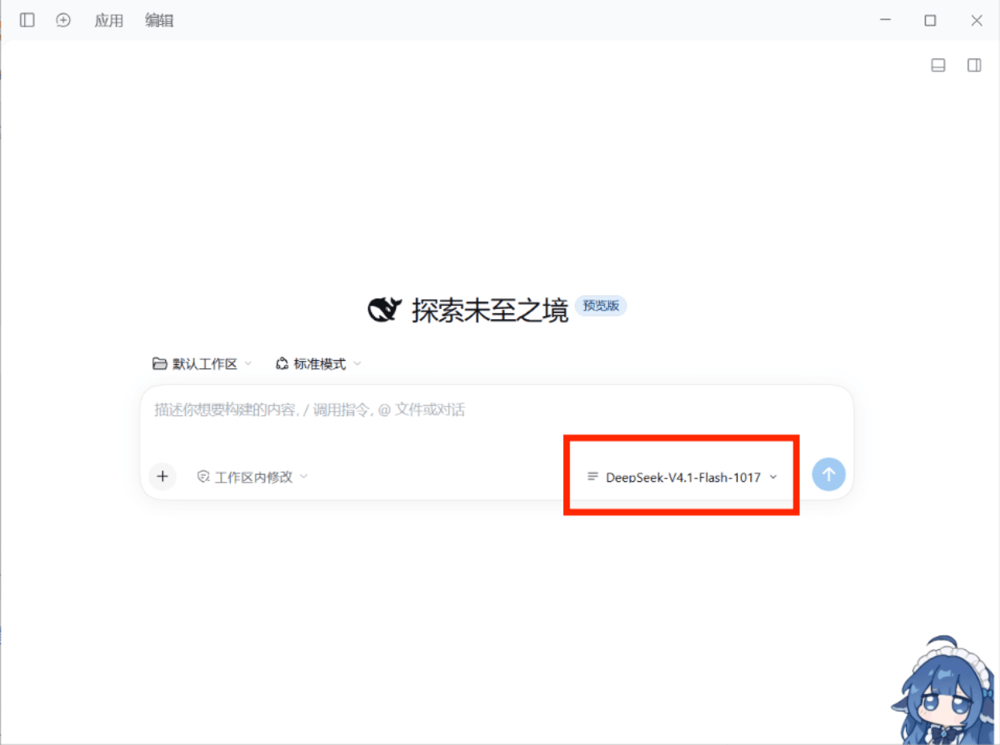
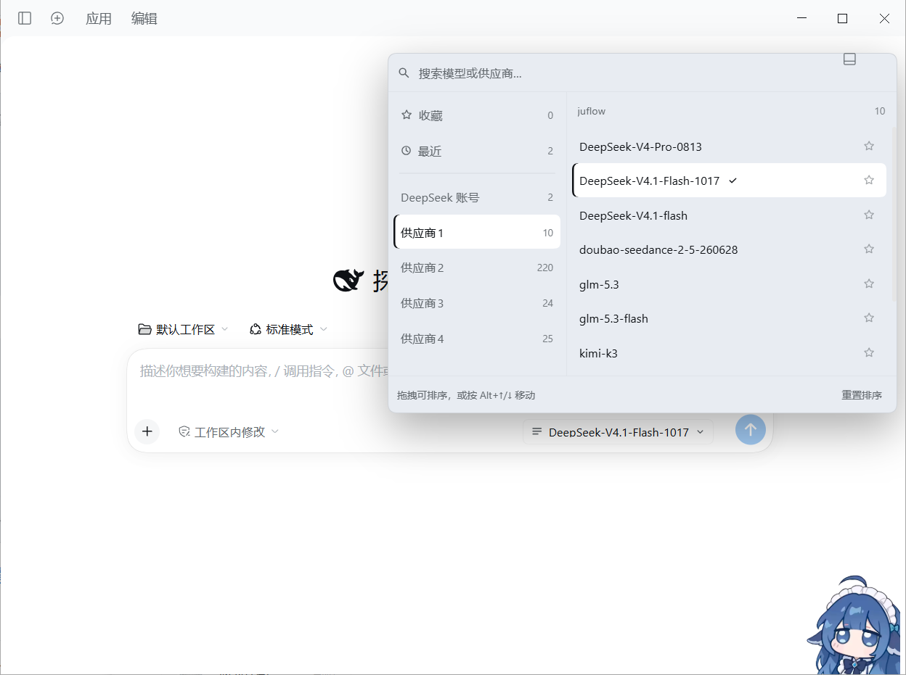

# Quick Model Switch

[](https://github.com/aichixiaojuzi/dsh-model-quick-switch/actions/workflows/ci.yml)
[](https://www.npmjs.com/package/@aichixiaojuzi/dsh-model-quick-switch)
[](https://github.com/aichixiaojuzi/dsh-model-quick-switch/blob/main/LICENSE)

A DSH Web client plugin that replaces the composer's **Model** menu with a
**provider-first, two-pane panel**.



*① A new session — the plugin takes over the Model seat in the composer's tool row*



*② The panel expanded — every provider in the left rail, the selected provider's models on the right*

[中文说明](https://github.com/aichixiaojuzi/dsh-model-quick-switch/blob/main/README.md) · [Changelog](https://github.com/aichixiaojuzi/dsh-model-quick-switch/blob/main/CHANGELOG.md) · [Contributing](https://github.com/aichixiaojuzi/dsh-model-quick-switch/blob/main/CONTRIBUTING.md)

## Why

The shipped picker groups models behind a nested dropdown. Once you have a few
providers, switching means walking down through levels. This plugin puts **every
provider in the left rail, one level deep**: hover a provider to swap the model
list on the right, click a model to switch. Ordering, aliases, pins and recents
are all yours to arrange.

## Install

```powershell
# desktop app (profile named "desktop")
dsh plugin --profile desktop add @aichixiaojuzi/dsh-model-quick-switch

# web profile
dsh plugin --profile web add @aichixiaojuzi/dsh-model-quick-switch
```

Or search for `dsh-model-quick-switch` in the in-app **plugin market**.

From source (clone it first):

```powershell
dsh plugin --profile desktop add link:C:/path/to/dsh-model-quick-switch
```

Reload the page afterwards. The model entry in the composer toolbar becomes this
panel's trigger.

## Features

- **Two panes** — left: pins / recents / every provider; right: that provider's models.
- **Clear current state** — the selected model and its provider in the rail share the
  same highlight (filled background plus a brand-coloured bar on the left). Hovering
  only tints a row temporarily; move away and just the current selection stays lit.
- **Drag to reorder** — provider order, model order inside each provider, and pin
  order. Keyboard users can move the focused row with `Alt + ↑/↓`.
- **Pins** — the star on any model row keeps it at the top under **Pinned**.
- **Recents** — the last 12 successful switches, recorded automatically.
- **Search** — fuzzy match on model name, provider name and your aliases, across providers.
- **Reasoning effort** — the selected model exposes the levels its adapter declares;
  click one to switch.
- **Model badges** — catalog tags (for example `new`) render next to the model name.
- **Keyboard** — `↑/↓` move, `Home/End` jump, `PageUp/PageDown` page, `Enter` select, `Esc` close.
- **Visible failures** — when a provider's catalog fails to load, the right pane shows
  the Host's own error message plus a **Retry** button instead of an empty box.
- **Never steals an unusable seat** — in sessions where model selection is unavailable
  (addressed subagent sessions, for example) the plugin renders nothing and leaves the
  seat to the shipped UI.

## Provider context menu

Right-click any provider in the left rail (real providers only, not Pins/Recents):

| Item | Effect |
|---|---|
| Rename | Edit a **local display alias** in place: `Enter` saves, `Esc` cancels, empty restores the original. Aliases participate in search but never change the underlying id or the request. |
| Open the panel on this provider | Makes it the provider the panel lands on next time; click again to clear (the dot on the right marks the default). |
| Pin to top / Move up / Move down | Reorder without dragging; items grey out at the boundaries. |
| Reset this group's model order | Clears the model order of that provider only. |
| Pin all / Clear this group's pins | Bulk add or remove that provider's models from **Pinned**. |
| Reload model catalog | Pick up new models or keys without reloading the page. |

## Data and boundaries

- Selection goes through the shipped `ctx.modelDirectories` service (the same
  `session.selectModel`), so the `/model` popup and this panel can never disagree;
  a Host rejection is shown in red at the bottom of the panel.
- Order, aliases, the default provider, pins and recents live in **browser
  localStorage** under `dsh.model-quick-switch.v1`. The plugin writes no profile
  configuration, adds no Host route and registers no locale namespace.
- It replaces exactly one visual seat: `conversation.input.model`.
- With more than 8 providers a filter box appears above the rail (it stays hidden
  below that to save space).
- No network access, no telemetry, no credential access. It only reads the model
  catalog the Host already publishes.

## Uninstall

Disable the bundle on the plugins page and the shipped selector returns immediately.
To drop its data too, delete the `dsh.model-quick-switch.v1` localStorage entry.

## Development

```powershell
# render / behaviour smoke test (34 assertions: context menu, aliases, default
# provider, filter, badges, empty-catalog fallbacks)
node dev/smoke.mjs

# syntax checks
node --check client.js
node --check index.js
```

There is no build step: the profile loads `client.js` directly, so a page reload
picks up your edits.

## Known limitations

- If a pinned model disappears from the catalog its key is kept, and it returns to
  Pinned when the model comes back.
- The trigger keeps showing the model name on narrow widths (truncated) rather than
  collapsing to an icon.
- Rename is display-only; catalog names come from the Host and are never rewritten.
- The model catalog is cached by the Host, so models added after the page loaded only
  appear once the Host refreshes.

## License

[MIT](https://github.com/aichixiaojuzi/dsh-model-quick-switch/blob/main/LICENSE) © 2026 aichixiaojuzi
