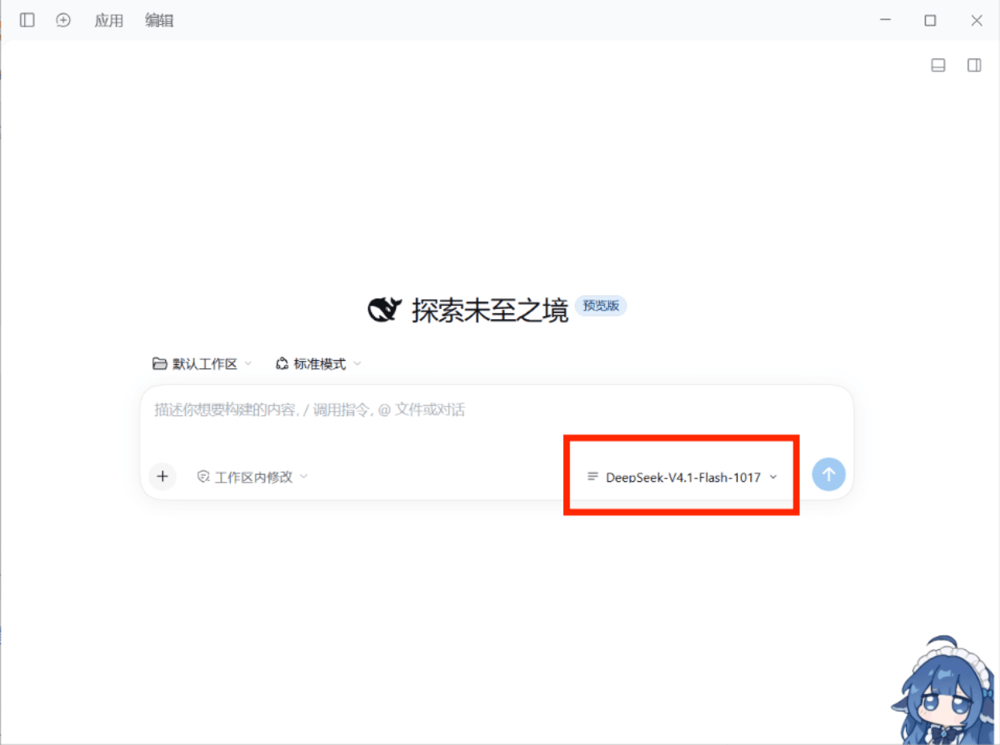
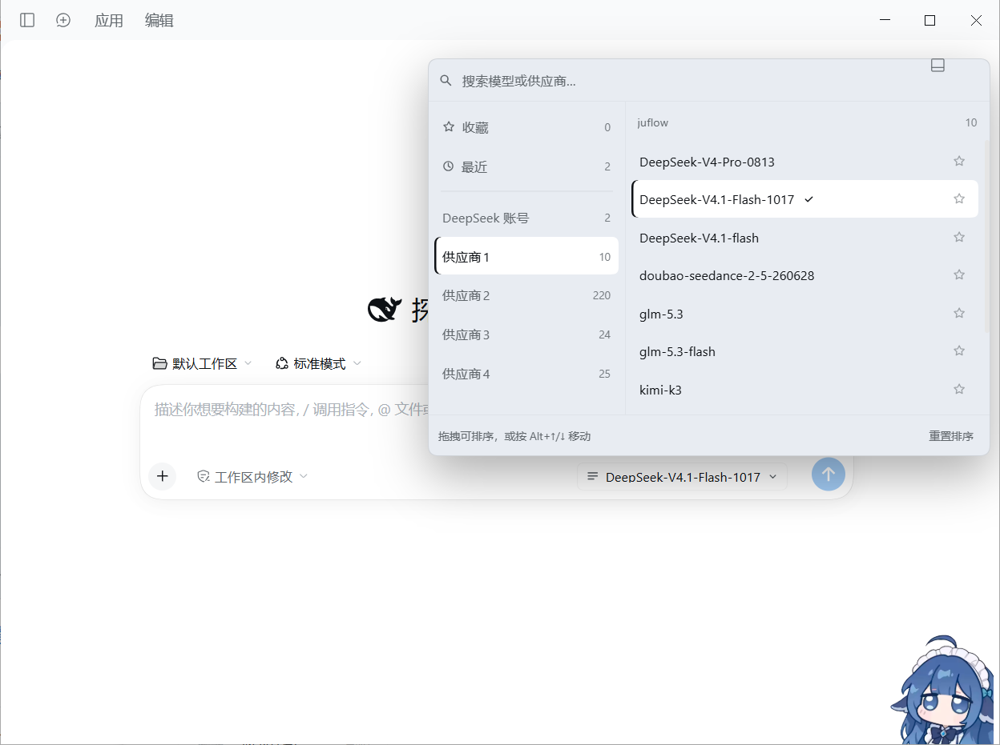

# 模型快捷切换 · Quick Model Switch

[](https://github.com/aichixiaojuzi/dsh-model-quick-switch/actions/workflows/ci.yml)
[](https://www.npmjs.com/package/@aichixiaojuzi/dsh-model-quick-switch)
[](https://github.com/aichixiaojuzi/dsh-model-quick-switch/blob/main/LICENSE)

一个 DSH Web 客户端插件：把输入框工具行里的「模型」菜单换成**供应商优先的双栏面板**。



*① 新会话界面：插件就装在输入框工具行的「模型」位置*



*② 点开后展开的完整面板：左侧是所有供应商，右侧是该供应商的模型*

[English](https://github.com/aichixiaojuzi/dsh-model-quick-switch/blob/main/README.en.md) · [更新日志](https://github.com/aichixiaojuzi/dsh-model-quick-switch/blob/main/CHANGELOG.md) · [参与贡献](https://github.com/aichixiaojuzi/dsh-model-quick-switch/blob/main/CONTRIBUTING.md)

## 它解决什么

供应商一多，官方那个分组下拉要一层层找。这个插件让**所有供应商在左侧一级菜单里直接可见**，
鼠标扫过就换右边的模型列表，点一下即切换。排序、别名、收藏、最近使用都按你自己的习惯来。

## 安装

```powershell
# 桌面端（profile 名为 desktop）
dsh plugin --profile desktop add @aichixiaojuzi/dsh-model-quick-switch

# Web 端（profile 名为 web）
dsh plugin --profile web add @aichixiaojuzi/dsh-model-quick-switch
```

也可以在 GUI 的**插件市场**里搜 `dsh-model-quick-switch` 安装。

从源码安装（先 clone 到本地）：

```powershell
dsh plugin --profile desktop add link:C:/path/to/dsh-model-quick-switch
```

装好后刷新页面。输入框工具行原来的模型入口会变成这个双栏面板的入口。

## 功能

- **双栏**：左列 = 收藏 / 最近 / 全部供应商（一级可见）；右列 = 该供应商的模型。
- **选中态**：已选模型与左侧当前供应商同一种高亮（实心底色 + 左侧品牌色竖条）；
  鼠标扫过只给临时底色，移开就只剩「当前选中」那一行亮着。
- **拖拽排序**：供应商顺序、每个供应商内的模型顺序、收藏顺序都能拖；
  键盘用户按 `Alt + ↑/↓` 移动当前行。
- **收藏**：点模型行右侧的星标，长期置顶在「收藏」里。
- **最近使用**：每次成功切换自动记录最近 12 个。
- **搜索**：顶部输入框按模型名 / 供应商名（含你起的别名）模糊匹配，跨供应商出结果。
- **推理强度**：选中模型后，行下方展开该模型适配器声明的档位，点一下即切档。
- **模型 badge**：目录自带的标签（如「新」）显示在模型名旁。
- **键盘**：`↑/↓` 移动、`Home/End` 首尾、`PageUp/PageDown` 翻页、`Enter` 选定、`Esc` 关闭。
- **失败可见**：某个供应商的目录加载失败时，右栏显示 Host 的原始报错和「重试」按钮，
  而不是静默空白。
- **不抢座位**：会话不可用时（例如子代理会话）主动留空，把位置交还官方席位。

## 供应商右键菜单

在左侧任一供应商上右键（仅限真实供应商行，不含「收藏/最近」）：

| 菜单项 | 作用 |
|---|---|
| 重命名 | 就地改**本机显示别名**，回车保存、Esc 取消、留空恢复原名。别名会参与搜索，但不改底层 id、不影响调用 |
| 打开面板时默认选它 | 面板每次打开都停在这个供应商；再次点选可取消（右侧圆点标记当前默认） |
| 置顶 / 上移 / 下移 | 不拖拽也能排序，到达边界时自动置灰 |
| 重置该组模型顺序 | 只清掉这个供应商的模型顺序，不影响别组 |
| 全部加入收藏 / 清空该组收藏 | 批量把该供应商的模型收进「收藏」或全部移出 |
| 重新加载模型目录 | 加完 key 或模型后不用刷页面 |

## 数据与边界

- 选择走官方 `ctx.modelDirectories` 服务（同一个 `session.selectModel`），
  `/model` 弹窗与这里永远一致；Host 拒绝会以红字显示在面板底部。
- 顺序、别名、默认供应商、收藏、最近都保存在**浏览器 localStorage**（`dsh.model-quick-switch.v1`），
  不写 profile 配置、不新增 Host 路由、不注册 locale 命名空间。
- 只替换 `conversation.input.model` 这一个可视席位。
- 供应商超过 8 个时，左侧顶部会出现过滤框（≤8 个不显示，避免占地方）。
- 插件不联网、不上报、不读取任何密钥；它只读 Host 已经下发的模型目录。

## 卸载

插件页禁用该 bundle，官方模型选择器立刻回来。收藏与排序数据要一并清掉的话，
删除浏览器的 `dsh.model-quick-switch.v1` 这一条 localStorage 即可。

## 开发

```powershell
# 渲染 / 行为冒烟测试（34 项断言，含右键菜单、别名、默认供应商、过滤、badge、空目录兜底）
node dev/smoke.mjs

# 语法检查
node --check client.js
node --check index.js
```

改动 `client.js` 后不需要重新构建：客户端模块由 profile 直接加载，刷新页面即可。

## 已知限制

- 收藏里若某个模型暂时从目录中消失，它的键仍保留，重新出现时回到收藏里。
- 触发按钮在窄屏下仍显示模型名（超出省略），不做图标化收缩。
- 「重命名」只改显示名；目录名称本身来自 Host，插件不改写。
- 模型目录由 Host 缓存，切换供应商后新增的模型需要 Host 那边刷新才会出现。

## 许可

[MIT](https://github.com/aichixiaojuzi/dsh-model-quick-switch/blob/main/LICENSE) © 2026 aichixiaojuzi
